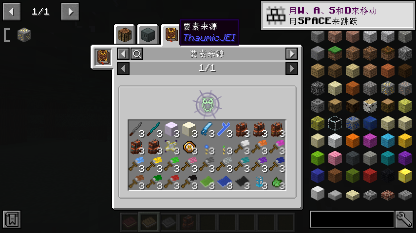
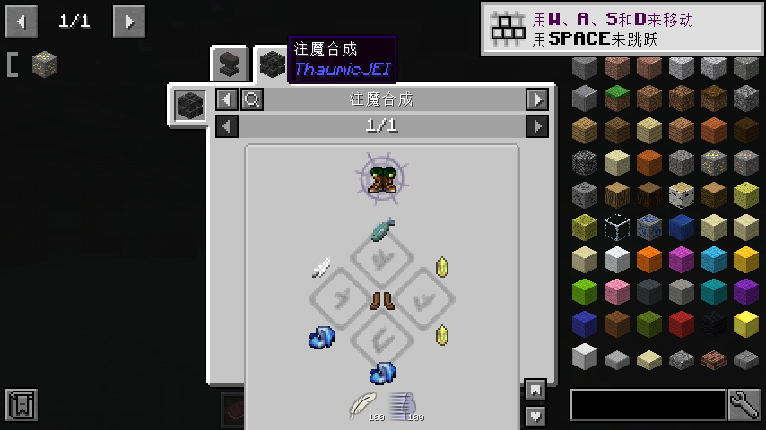
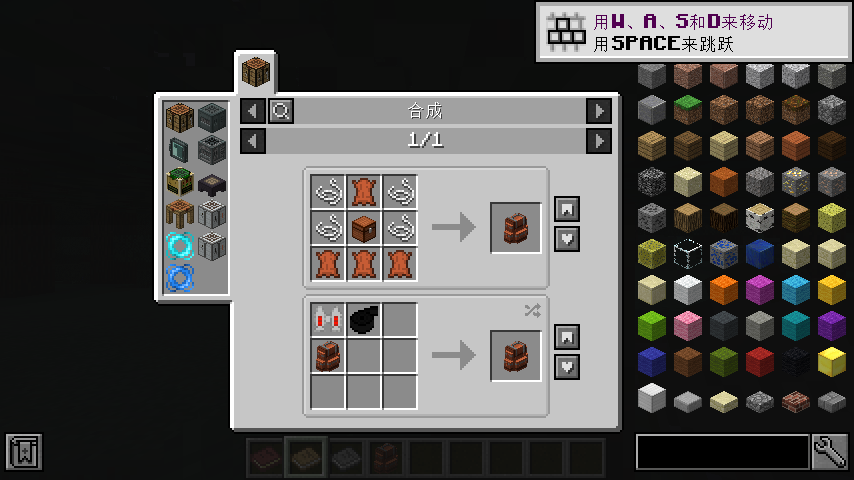

# ThaumicJEI Cleanroom

A Java 25 refactor of ThaumicJEI for **Minecraft 1.12.2 + Cleanroom 0.6.13-alpha**.

It keeps the original recipe-browser features while moving item-aspect derivation off the JEI query
and tooltip path. Aspects are derived once into an immutable snapshot, then reused read-only.

> **Attribution:** this is a code refactor based on
> **[Buuz135/Thaumic-JEI](https://github.com/Buuz135/Thaumic-JEI)**, used under the MIT License.
> Upstream Git history is retained as this repository's base. This project is not affiliated with or
> endorsed by the original author. See [upstream and attribution](docs/upstream/README.md).



<details>
<summary>More screenshots</summary>





</details>

## Why use it

On large modpacks, deriving aspects during JEI queries can saturate a core and stall the client,
especially when pressing **R** or **U** on an item.

This refactor instead provides:

- **Snapshot-only lookups** — a tooltip or recipe query never starts aspect derivation.
- **Budgeted generation** — the evaluator runs across client ticks with pause/cancel controls.
- **A fixed cache** — generate once and reuse read-only; no startup fingerprinting, automatic
  invalidation or unknown-item backfill.
- **Safe replacement** — a new snapshot is published only after a complete generation and an atomic
  file save. The previous cache survives cancellation or failure.

The trade-off is intentional: displayed values can remain fixed across launches instead of being
recomputed from every small change in Thaumcraft's own scan.

## Requirements

| Component | Supported version |
|---|---|
| Minecraft | 1.12.2 |
| Loader | Cleanroom **0.6.13-alpha** |
| Java | **25** |
| Thaumcraft | 6.1.BETA26 |
| JEI / HEI | JEI 4.16.1 or HEI 4.32.0+ |

Not supported: Cleanroom 0.7+, Java 8 and the original ForgeGradle/Java 8 runtime combination.

## Install

Download the release build:

```text
https://github.com/Evsdrg/ThaumicJEI-Cleanroom/releases/tag/1.12.2-2.0.0-beta.2
```

The asset to install is `ThaumicJEI-Java25-1.12.2-2.0.0-beta.2.jar`. `SHA256SUMS` in the same
release lists the expected checksums.

1. Exit the game and back up your existing ThaumicJEI JAR and cache.
2. Keep only one mod with modid `thaumicjei`; do not install JEI and HEI together.
3. Install the remapped release JAR, not a `-dev`, `-sources` or differential variant.
4. On first launch without a cache, allow generation to finish. Later launches reuse the complete
   `config/thaumicjei-cache-v2.json`.

After pack or recipe changes, use `/thaumicjei rebuild` when you want to regenerate. See the
[fixed-cache guide](docs/cache.md) for all commands and failure behaviour.

## Documentation

- [Architecture](docs/architecture.md) — packages, lookup/generation paths and source sets.
- [Fixed cache](docs/cache.md) — lifecycle, commands, configuration and exact-NBT behaviour.
- [Building](docs/building.md) — toolchain, artifacts and differential-variant precautions.
- [Testing](docs/testing.md) — 44 unit tests, differential checks and validation limits.
- [Changelog](CHANGELOG.md) — this refactor's release notes.
- [Documentation index](docs/README.md) — including screenshot and asset-path conventions.

## Build and test

```bash
JAVA_HOME=/path/to/java25 ./gradlew \
  -Porg.gradle.java.installations.paths=/path/to/jdk8,/path/to/java25 build
```

JDK 8 is used only by legacy MCP tooling; the mod itself is compiled for Java 25. See
[Building](docs/building.md) before producing a release artifact.

## Validation status

Verified on an independent 118-mod pack with 18,813 deduplicated items: complete generation with zero
skips, warm cache loading without evaluator work, R/U lookups, source pages, safe rebuild/cancel and
representative Thaumcraft recipe categories after research unlock.

This is not a claim of exhaustive coverage or GPU performance. The detailed list of tested and untested
behaviour is in [Testing](docs/testing.md). Multiplayer is out of scope: the mod is client-side only
and has no custom network protocol.

## Contributing and license

See [CONTRIBUTING.md](CONTRIBUTING.md) for repository layout, build checks and submission hygiene.

Released under the [MIT License](LICENSE), retaining the original `Copyright (c) 2017 Buuz135` notice.
The upstream historical changelog is kept separately in
[`docs/upstream/CHANGELOG.md`](docs/upstream/CHANGELOG.md).

[中文说明](README.zh-CN.md)